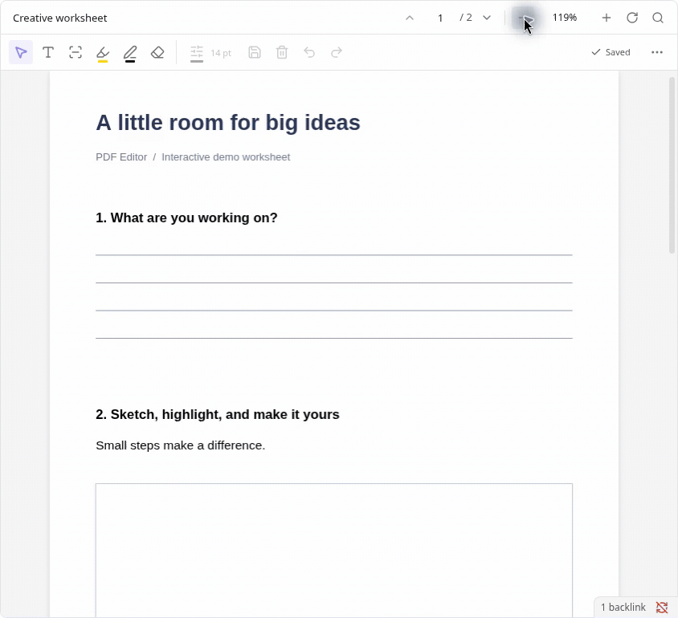
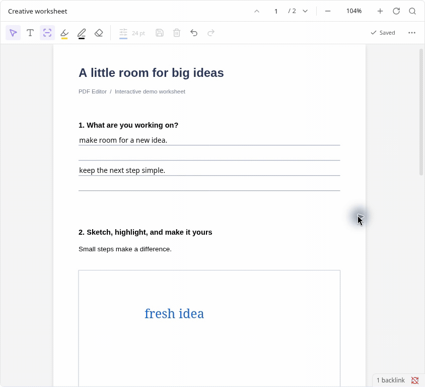
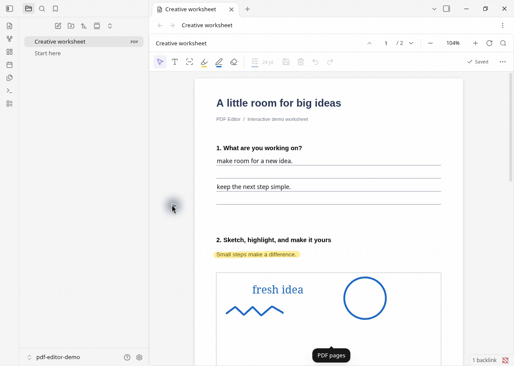

# PDF Editor

Write, fill answers, highlight and draw on PDFs without leaving Obsidian. Works in PDF tabs, notes and pop-out windows.

### Write and fill answers

Existing editable form fields show their borders and backgrounds; click a field to type. Authored fields keep their geometry, alignment, length limits and multiline options. Opening a PDF or clearing an existing answer retains its blank fields. Only newly placed, unsaved empty boxes disappear when abandoned. Read-only and unsupported form fields retain their original appearances.

Text settings include Left, Center and Right alignment. Added text boxes also have letter spacing in PDF points (0–20 pt) and line spacing as a multiplier (0.8–3×, default 1.2×). These settings are saved in editable PDF appearances and shared undo/redo history. Authored forms retain their alignment until explicitly changed; spacing controls are disabled for authored forms. Ruled answer blocks keep their detected line pitch until resized into ordinary boxes.

The spacing controls share one compact row. Drag either the icon or number horizontally, including while the number is focused (right increases, left decreases). Click a number to edit with the keyboard, use decimal points or commas, and step with Up/Down. Keyboard text selection and clipboard shortcuts stay within the value input. Each control has a reset button: **0 pt** for letter spacing and **1.2×** for line spacing. A completed drag or reset is one undo operation; Escape, pointer cancellation, loss of window focus or closing the control cancels a drag preview. The panel follows the captured box's undo/redo state. Text-box resizing uses one printable grapheme's font advance plus insets, or an M for an empty box, instead of a fixed 40-point floor. Wider remaining characters that cannot fit produce an explicit save error; text is retained without shrinking the font.

Text widgets omitted from the PDF's form tree are recovered when their identities and hierarchy are unambiguous. They become editable without changing the file on open; the recovered form tree is saved with the next edit. Ambiguous names and malformed field hierarchies are rejected before editing.

Apple Preview can rewrite a PDF while retaining obsolete compressed objects. For standalone classic cross-reference tables, PDF Editor follows the active object index so those obsolete objects cannot replace the current pages or form fields. Preview drawing and FreeText annotations retain their appearances; they do not become editable PDF Editor text boxes. Opening a file does not write this compatibility adjustment back to the source. Valid compressed cross-reference streams, hybrid indexes, incremental updates and files missing the footer or trailer's object count retain the existing loading path. Explicit invalid object counts, recognized invalid footer index pointers and genuinely malformed active form hierarchies still reject editing.

### Draw and highlight

In Select mode, selected editable drawings, held shapes and marker strokes have eight resize handles. Drag a handle to resize the PDF-space points while keeping the opposite anchor, color, opacity, line width and annotation identity. Hold Shift at a corner for proportional resizing. Focus a handle and use arrow keys for small adjustments. Each completed resize is one undo operation; Escape, pointer cancellation, focus loss, tool changes and document replacement cancel an unfinished preview.

Highlighter options include **Snap to text**, off by default. It follows the rendered PDF.js word geometry crossed by a gesture and keeps separate lines and distant columns as separate editable marker strokes. Snapped marks fit the text height and use the selected brush thickness as a minimum; the preview and saved appearance use the same width. A whole gesture shares one undo operation. Scanned pages, unavailable or skewed text geometry, pages above 5,000 measured words and complex gestures fall back to freehand; no OCR is performed. Text geometry is measured on demand and discarded when a page is rerendered or released. Straight-line assistance remains available.

The 0.8.2 drawing candidate was checked on 2026-10-14 in an isolated Obsidian 1.14.4 vault on macOS 27.0.1. A PDF tab showed the eight handles; a completed resize, toolbar undo/redo and autosave were observed. PDF.js independently read the resized saved points and appearance, unchanged line width and untouched second stroke. The final cancellation, snapped-width and NUL-header compatibility adjustments have automated regression coverage; fresh native checks after those adjustments remain unavailable. A native Cmd+Z trial produced no observable undo, and window targeting then stopped responding. Snap-to-text gestures, Reading view, Live Preview and pop-out interactions remain unverified for this candidate. Earlier surface checks below predate it. Automated tests cover PDF.js geometry at all quarter turns and 35–300% zoom, multiline grouping, fallback, cancellation, preserved redo, autosave release, shared history, saved annotations and reopen.

### Edit inside your notes

Vertical wheel input scrolls the PDF while it has room, then sends the remaining distance to the enclosing note at either boundary. A PDF without a vertical scroll range lets the note scroll. Horizontal input retains native scrolling. Cmd/Ctrl+wheel and two-touch pinch handlers zoom around the pointer or midpoint within 35–300%; Fit width resets the view. Zoom's extra canvas margins do not trap vertical wheel input in blank space.

In Select mode, drag across printed PDF text, then use Cmd/Ctrl+C to copy. The editor's text layer permits selection independently of Obsidian's native PDF container.

Cmd/Ctrl+Z and Cmd/Ctrl+Shift+Z use the PDF's shared undo/redo history while its canvas or controls own keyboard focus, including after drawing without selecting the mark. Editable inputs retain native text undo. Moving focus to the note restores its shortcuts. Hover help uses short names for tool icons and unfamiliar controls; PDF pages, save status and routine controls have no visible hover tooltip. Accessible names remain available.

Development validation on macOS 27.0.1 with Obsidian 1.14.4 checked PDF tabs, Live Preview, Reading view and a PDF pop-out, including Unicode text, compact settings, spacing edits, toolbar undo/redo, shared pop-out edits, saves and reopen. Upward note handoff was observed in Live Preview. Regression tests independently inspect saved appearances with PDF.js and cover alignment, tracking, wrapping, glyph resize limits at quarter turns, zoom anchoring with clamped scroll bounds, Fit width at an unchanged scale, modifier-wheel cancellation of text placement, history ownership and interrupted scrubs. Physical pinch/momentum and native undo/redo shortcuts remain unconfirmed: native automation lost its isolated-window target during testing. The final zoom-margin and wheel-cancellation adjustments are covered by automated tests but have not been exercised with native wheel input. Real Downloads drops, duplicate-name imports and interrupted gestures across every surface also remain unverified. These development changes have not been released.

Large documents retain page geometry while mounting editing controls only near the viewport or on pages with focus, selected objects or active gestures. Rapid scrolling replaces stale render destinations, cancels distant raster/text tasks and releases distant page resources. Printed-text selections retain their pages until copying ends. Internal PDF scrolling leaves the viewer controls in place; scrolling the enclosing note still updates the floating toolbar.

An anonymous 450-page fixture was checked in an isolated Obsidian 1.14.4 vault on macOS 27.0.1: PDF tabs, Reading view, Live Preview and a note pop-out loaded and navigated, including repeated Page Up/Down input. A last-page form edit survived save/reopen and independent PDF.js verification. Automated fixtures reduced mounted editing layers from 450 to 3; a scripted browser scroll test reduced toolbar geometry checks from 179 to 0, with similar frame timing in both builds. These measurements show reduced work, not a guaranteed speedup for every PDF. Native fast wheel/trackpad scrolling and the reported counter jump could not be reproduced reliably because wheel automation could not target the isolated window; keyboard scrolling kept the counter in its toolbar.

The selection/spacing follow-up was checked on 2026-10-13 with Obsidian 1.14.4 on macOS 27.0.1. Native PDF-tab drag selection and copy/paste worked, and the compact controls fit without clipping. Browser pointer tests checked focused and unfocused number dragging, keyboard decimal edits and resets; regressions cover cancellation, clipboard ownership, undo/redo and save/reopen. Native spacing drags and fresh Reading view, Live Preview and pop-out checks remain unconfirmed: automation lost the isolated window when the active vault changed. Earlier surface checks above predate this follow-up.

The preview-shortcut and hover-help follow-up adds regressions with the host keymap capture handler registered before the PDF editor, matching the inspected Obsidian 1.14.4 event order. These cover unselected drawings, undo/redo, empty history, repeated keys, input undo routing, composition, floating controls, window focus, disposal and saved content. Fresh native checks across the four surfaces remain unconfirmed because the active vault window changed during automation. The final browser check was unavailable after two collaborative-browser snapshot timeouts; alternate browser controls were unavailable. The final assets were copied into the isolated test vault, but that copy alone does not verify native interaction.

The Preview compatibility follow-up was checked on 2026-10-13 with Obsidian 1.14.4 on macOS 27.0.1 using an anonymous two-page fixture retaining obsolete compressed objects. Live Preview, Reading view, a PDF tab and a PDF pop-out opened both pages and the existing fields. Native checks covered edits to an authored field and an added text box, toolbar undo/redo, save/reopen and a clean external replacement shared across views. PDF.js independently verified the saved logical values and unchanged foreign annotation pixels. Regression tests also cover repeated saves, verified original recovery, pending-edit conflicts, history reset on reload and malformed active indexes. The footer-pointer adjustment was checked on the same four surfaces with an anonymous missing-footer fixture, including field editing, save/reopen and toolbar undo/redo. An invalid-pointer fixture showed a blocking error and its bytes remained unchanged. A native Cmd+Z trial in the pop-out produced no observable undo; keyboard shortcut compatibility remains unconfirmed. Physical pinch, stylus and interrupted pointer gestures were not retested for this loading-only change.

## Get started

[Open the Community plugin listing](https://community.obsidian.md/plugins/pdf-editor) and choose **Add to Obsidian**.

For manual installation, copy `main.js`, `manifest.json` and `styles.css` from the [latest release](https://github.com/holtsdav/PDF-Editor/releases/latest) into `.obsidian/plugins/pdf-editor/`, then enable **PDF Editor**.

Desktop only, Obsidian **1.13.7+**. Tested on Linux 1.14.4, with a basic check on 1.13.7; macOS 1.14.4 is user-confirmed. Windows and mobile are unverified.

**Beta:** keep backups and edit each PDF in only one app or device at a time. Wait for **Saved** and sync to finish before switching. Existing printed text cannot be rewritten; not every PDF is supported.

The PDF picker enumerates vault file names to find PDFs. Copy and paste use the system clipboard when invoked in the active PDF editor; pasted text can become PDF content. PDF Editor does not poll the clipboard in the background.

**Move original PDF to Trash after import** is an optional setting, off by default. It observes a native external PDF drop into a note, checks the actual returned attachment through vault APIs, and rechecks the dropped source's identity and bytes before using system Trash. It never permanently deletes files or finds originals by filename. Failed, cancelled, changed, ambiguous or unsupported imports skip cleanup. Vault PDFs, recovery copies, symbolic links and hard-linked sources are excluded. Batches above 32 PDFs or 100 MB skip cleanup; overlapping drops into the same note also retain native import without cleanup. Enabling the setting authorizes automatic cleanup without per-import confirmation.

Cleanup uses isolated desktop compatibility hooks for the native import pipeline. Current Obsidian editor components and legacy import handlers are recognized, including native Buffer and Uint8Array payloads with nonzero offsets. Ambiguous or foreign handlers skip cleanup. Host changes can make it unavailable. Verifying a filesystem path and moving it to Trash are separate operations, so an external replacement in the final verification/Trash interval cannot be ruled out. Regression tests cover exact attachment association, byte snapshots and slice boundaries, duplicate filenames, mixed-success batches, note changes during verification, overlap, cancellation, source changes, large filesystem identifiers, settings persistence and Trash failures.

The setting's default and saved toggle states were checked in an isolated Obsidian 1.14.4 vault on macOS 27.0.1. On 2026-10-13, a real OS File selected through the native file chooser and a constructed drop event reproduced the skipped-cleanup notice through Obsidian's actual import handler. The compatibility fix then retained native attachment and embed creation and moved the disposable original to system Trash; the attachment and Trash copy had identical bytes and independently opened with PDF.js. After a full app reload, the imported PDF opened in Live Preview, Reading view, a PDF tab and a PDF pop-out. These were opening checks, not a new gesture or shortcut audit. Automated Finder-to-note dragging did not reach the note, so physical Downloads drops and imports into pop-out notes remain unverified. No personal Downloads files were used.

[MIT license](LICENSE) · [Third-party credits and licenses](THIRD_PARTY_NOTICES.txt)

## Changelog

### 0.8.2

Changes since 0.7.15, including PRs #22 through #28 and the remaining drawing features:

- **Text alignment:** Left, Center and Right, saved in the PDF and included in undo/redo.
- **Letter spacing:** PDF-point control for added text boxes, defaulting to 0 pt.
- **Line spacing:** Multiplier control for added text boxes, defaulting to 1.2×.
- **Compact spacing controls:** Side-by-side controls with draggable icons and number fields, keyboard editing, decimal commas and quick reset buttons.
- **Smaller text boxes:** Minimum width based on one character at the actual font and size.
- **Zoom gestures:** Pinch and Cmd/Ctrl+wheel handlers that keep the pointer's PDF position stable.
- **Embedded scrolling:** Scroll handoff between the PDF and enclosing note at the PDF's boundaries.
- **Large-PDF performance:** Nearby-page rendering and editing layers, cancellation of stale work and release of distant resources.
- **Page-counter positioning:** Viewer controls stay in their toolbar during internal scrolling.
- **Printed-text selection:** Restored selection and copying of PDF text.
- **Undo/redo ownership:** Preview shortcut routing and window-focus fixes using the shared history.
- **Simplified tooltips:** Short tool names, fewer routine tooltips and no page-hover tooltips.
- **Apple Preview compatibility:** Load rewritten PDFs while preserving current pages, forms and foreign annotation appearances, and accept valid NUL-separated object headers.
- **Drawing resize controls:** Resize editable pen drawings, held shapes and marker strokes, with proportional corner resizing and undo/redo.
- **Snap to text:** Optional highlighter snapping to crossed words and separate lines, with freehand fallback when geometry is unavailable.
- **Original-file cleanup:** Optional system Trash cleanup after a verified native PDF import, off by default. Current and legacy import handlers and native Buffer payloads are recognized.

Desktop beta. Physical pinch, stylus input, fast native momentum scrolling and Finder-to-note drops remain unverified. Existing printed text and foreign Preview text annotations do not become editable text boxes. Use one writer per PDF and wait for Saved before switching apps or devices.
