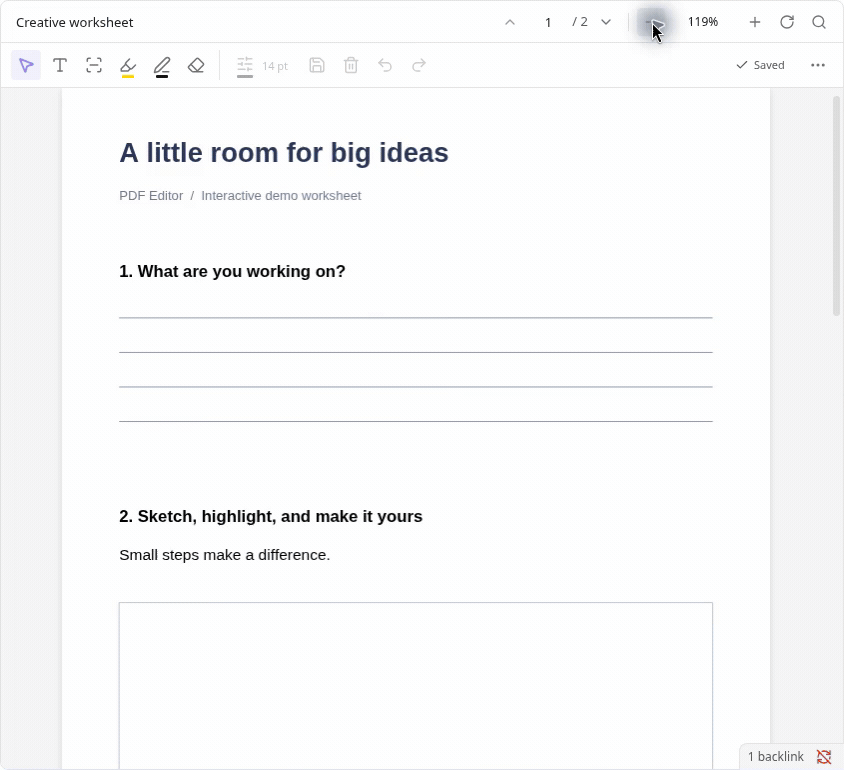
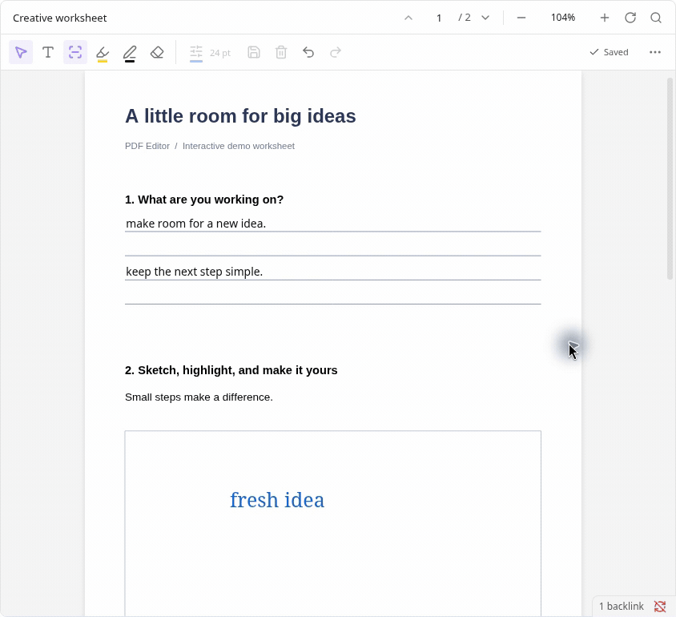
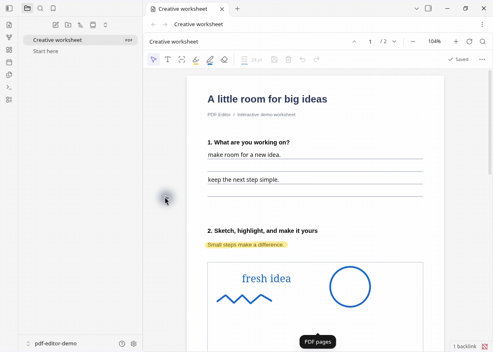

# PDF Editor

Write, fill answers, highlight and draw on PDFs without leaving Obsidian. Edit in PDF tabs, notes and pop-out windows.

### Write and fill answers

Click an editable form field to type, or add your own text box. Adjust font, size, color and alignment. Added text boxes also support letter and line spacing: drag a spacing value to adjust it, or click to type a number.

Use **Detect answer lines** to find places to type on worksheets. Longer answers can wrap across consecutive lines.

Checkboxes, radio buttons, dropdowns and list boxes in PDF forms can be filled in directly.

Text boxes support bulleted and numbered lists with indentation: use the list buttons in the toolbar, **Ctrl/Cmd + Shift + 8** or **7**, and **Tab** / **Shift + Tab**.

### Draw and highlight

Draw with the pen or highlighter, then select a mark to move or resize it. Hold **Shift** while dragging a corner to keep its proportions. Press **Escape** to cancel a drag.

Select printed text and press the highlight button in the toolbar (or the bar next to the selection) to highlight it, optionally with a comment; pressing it again on highlighted text removes that part. Add comment notes anywhere with the note tool. Highlights and notes are saved as standard PDF annotations, so other PDF readers show them, and highlights or notes made in other apps can be edited too. Underline or strike through selected text with the buttons next to the highlight button; pressing again removes it. These are standard underline and strikeout annotations too. The highlighter ribbon button or **Show highlights and comments of the PDF** opens a sidebar listing them by page, and **Export highlights and comments of the current PDF to a note** writes them with page links to a note.

Draw rectangles, ellipses (outline or filled), lines and arrows with the shape tool; choose kind, colour and width in its menu. Select a shape to move it, resize it from its handles, turn rectangles and ellipses with the round handle (**Shift** snaps to 15°), nudge it with the arrow keys or delete it. Shapes are saved as standard PDF annotations.

Paste a picture with **Ctrl/Cmd + V**, for example a screenshot taken with your system's tool, or insert an image file from the toolbar. Pictures can be moved, resized in proportion (**Shift** for free resizing), turned in 90° steps, locked, copied and duplicated, and are saved as standard stamp annotations.

Right-click shapes, pictures, highlights, notes, text boxes, drawings or an empty spot on the page for a menu with cut, copy, paste, duplicate, delete, turn, flip, lock, colours and comments.

Enable **Snap to text** in the highlighter options to follow printed text. When text is unavailable, highlighting falls back to freehand. Optional drawing assistance smooths strokes and snaps held lines and shapes.

### Edit inside your notes

Work in Reading view, Live Preview or a separate PDF window. Scrolling continues into the surrounding note when you reach the PDF's edge.

PDFs open in Obsidian's own viewer by default, so viewer plugins such as PDF++ keep working. Switch editing on for a PDF with the pencil button in its tab header, the file menu or the command palette, or turn on **Open every PDF in PDF Editor** in the settings.

Select printed text to copy it. Zoom with the viewer controls or **Cmd/Ctrl + wheel**, and use **Fit width** to reset; pages stay centred while zooming. The left and right arrow keys turn whole pages. Undo and redo are shared across views of the same PDF.

## Get started

1. Download `main.js`, `manifest.json` and `styles.css` from the [latest release](https://github.com/holtsdav/PDF-Editor/releases/latest).
2. Put them in `<your vault>/.obsidian/plugins/pdf-editor/`.
3. Enable **PDF Editor** under **Settings → Community plugins**.

Requires **Obsidian 1.13.7+**, desktop only. Windows support is unverified.

Saves are incremental: the original file bytes stay untouched and only changed objects are appended. After many editing sessions the file is rewritten once to stay compact.

**Beta:** Keep backups, edit each PDF in only one app or device at a time, and wait for **Saved** and sync before switching. Existing printed text cannot be rewritten. Encrypted PDFs, XFA forms and documents containing signature fields are not supported for editing.

[MIT license](LICENSE) · [Third-party credits and licenses](THIRD_PARTY_NOTICES.txt)

## Changelog

### 0.8.2

- Text alignment, letter spacing and line spacing with compact controls.
- Resizable drawings and optional highlighter snapping to text.
- Improved zoom, scrolling, printed-text selection and shared undo/redo.
- Better handling of large PDFs.
- Loading fixes for PDFs saved by Apple Preview and other editors, including incremental updates and empty object indexes.
- Optional Trash cleanup for imported originals, off by default.
